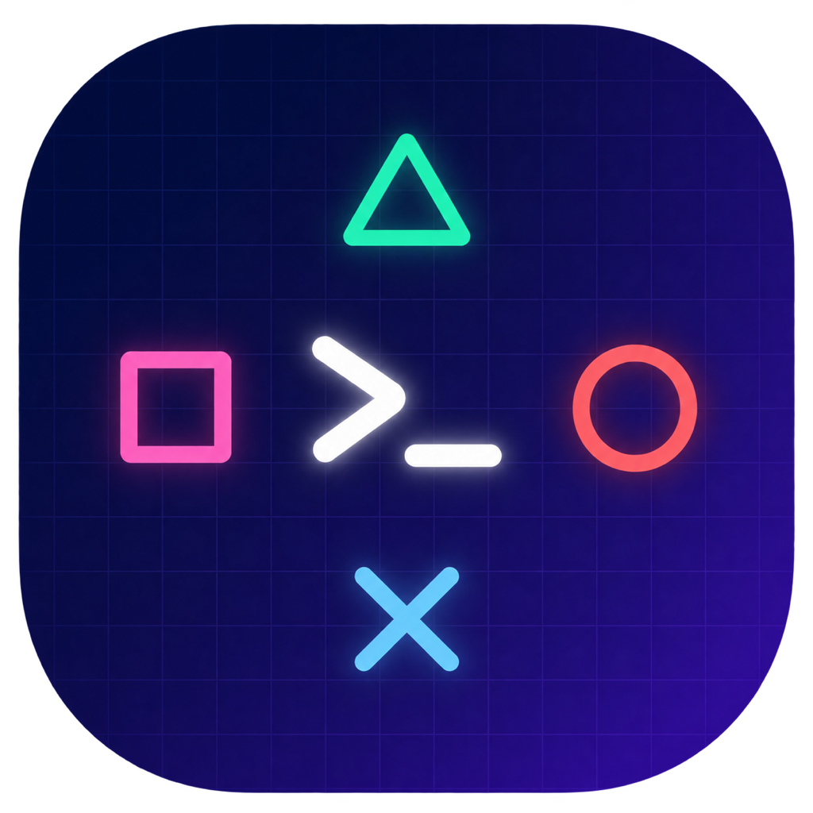
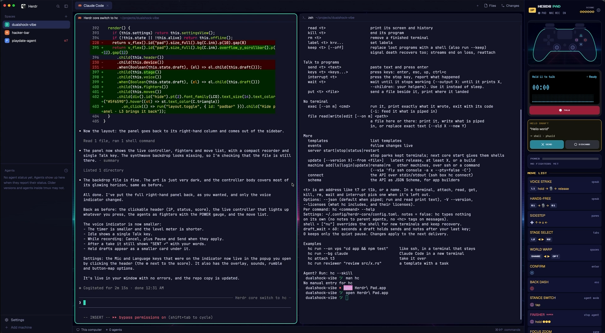
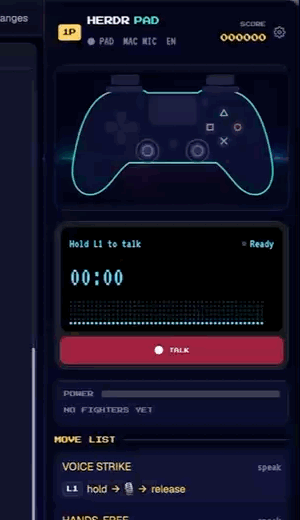
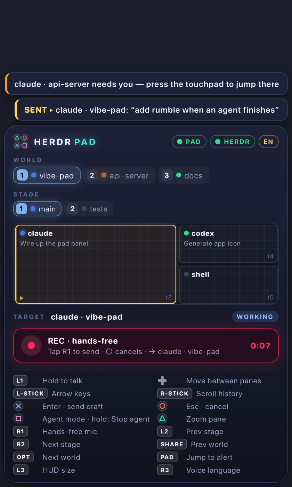

<div align="center">



# Vibe Pad

**Play your coding agents like a video game.**

Drive the [Herdr](https://herdr.dev) app with a PlayStation DualShock 4 controller. Hold L1, talk, release, and your words land in the focused agent. Switch panes with the D-pad and approve prompts with ✕, all from the couch.




<sub>▶ <a href="docs/demo.mp4">Watch the full demo (40 s)</a></sub>

</div>

---

## What it is

Vibe Pad is two pieces that work together:

| | |
|---|---|
| 🕹️ **Pad Arcade**, a Herdr layout and mod | An arcade cabinet in Herdr's right sidebar: a live controller that lights up as you press buttons, a pocket-recorder voice meter, your agents as fighters with health bars, and your controls as a fighting-game move list. |
| 🎙️ **herdr-pad**, the controller helper | A small native macOS helper that reads the DualShock over Bluetooth, records your voice (Mac mic or the headset plugged into the pad), transcribes it locally with Whisper, and drives Herdr. It ships inside the mod and starts by itself. |

<table>
<tr>
<td width="34%" valign="top">



</td>
<td valign="top">

### Highlights

- **Push-to-talk prompts.** Hold **L1**, speak, release. Whisper runs on your Mac, and the text goes to the agent you were looking at.
- **Hands-free mode.** Tap **R1** to start and tap again to send. Pause and resume from the panel.
- **Safe by default.** Dictation aimed at a plain shell is never run on its own: it waits as a *held draft* until you press ✕. The same happens when an agent is busy asking you a question.
- **Live controller.** Every button, the D-pad and both sticks light up and move on screen.
- **Agent alerts you can feel.** The pad rumbles and the lightbar flashes orange when an agent needs you. The touchpad jumps straight to it.
- **Game feel.** "SENT! K.O.", "3 HIT COMBO!", "STAGE CLEAR!" when an agent finishes, and a score that climbs as you ship.
- **Settings in one click.** Click the panel header to choose the Mac mic or the headset, English, Tiếng Việt or auto-detect, sounds, rumble and the overlay.

</td>
</tr>
</table>

## Quick start

**You need:** an Apple Silicon Mac, the [Herdr app](https://herdr.dev), and a DualShock 4 paired over Bluetooth.

```sh
git clone https://github.com/phucledien/vibe-pad
cd vibe-pad
./herdr-app/install.sh --switch
```

That copies the layout, the `pad` mod (with the prebuilt helper inside) and the theme into `~/.config/herdr-app`, then switches Herdr to **pad-arcade**. The panel starts the helper on its own, so there's nothing else to launch.

For voice prompts, install whisper.cpp and a model once:

```sh
brew install whisper-cpp
mkdir -p ~/.local/share/whisper
curl -L -o ~/.local/share/whisper/ggml-large-v3-turbo-q5_0.bin \
  https://huggingface.co/ggerganov/whisper.cpp/resolve/main/ggml-large-v3-turbo-q5_0.bin
```

> [!TIP]
> Switch back to your old layout any time with <kbd>ctrl</kbd>+<kbd>shift</kbd>+<kbd>L</kbd>, or in Settings → Look.

## Move list

| Move | Input | Does |
|---|---|---|
| **Voice strike** | <kbd>L1</kbd> hold → 🎙 → release | Record, transcribe, send to the focused agent |
| **Hands-free** | <kbd>R1</kbd> → 🎙 → <kbd>R1</kbd> | Same, without holding |
| **Sidestep** | D-pad ↑ → ↓ ← | Focus the pane in that direction |
| **Stage select** | <kbd>L2</kbd> ◀ ▶ <kbd>R2</kbd> | Previous / next tab |
| **World warp** | <kbd>SHARE</kbd> ◀ ▶ <kbd>OPTIONS</kbd> | Previous / next space |
| **Confirm** | ✕ | Enter, or send the held draft |
| **Back dash** | ○ | Esc, cancel a recording, or discard the draft |
| **Stance switch** | □ tap | Shift-Tab (cycles Claude Code's mode) |
| **Finisher** ⚡ | □ hold | Ctrl-C, to stop the agent |
| **Focus zoom** | △ | Zoom the pane |
| **Rescue** ⚡ | Touchpad click | Jump to the next agent that needs you |
| **Menu walk** | Left stick | Arrow keys, for agent menus and pickers |
| **Scroll** | Right stick | Scroll the pane's history |
| | <kbd>L3</kbd> / <kbd>R3</kbd> | Show or hide the panel / cycle voice language |

Every button can be remapped in `~/.config/herdr-pad/config.json` (**Edit button map…** in settings). A button takes an action, `{"tap": …, "hold": …}`, `keys:ctrl+r` or `text:…`.

### Lightbar

| Color | Means |
|---|---|
| 🔴 Pink-red | Mic is on |
| 🟣 Purple | Transcribing or sending |
| 🔵 Blue | Focused agent is working |
| 🟢 Green | Focused agent is idle or done |
| 🟠 Flashing orange | Focused agent needs you (another one waiting: steady orange) |

## The floating overlay

The helper also works outside Pad Arcade, with any layout or even any app. It sits in the menu bar (🎮) and shows a click-through overlay HUD with your spaces, tabs, a pane minimap, the voice state and the button guide. While Herdr is in front on Pad Arcade, the overlay hides itself, because the panel already shows everything.

<p align="center"></p>

## How it works

```
 DualShock 4 ──Bluetooth HID──▶ herdr-pad (native helper, in mods/pad/)
   buttons, sticks, headset mic      │  ├─ Mac mic (AVAudioEngine) or headset SBC decode
                                     │  ├─ whisper-cli (on-device transcription)
                                     │  ├─ herdr-app do pane.go / tab.next / space.next / …
                                     │  └─ hc keys / hc send  (prompts as you, untagged)
                                     ▼
                     ~/.config/herdr-pad/state.json
                                     ▼
                Pad Arcade panel (mods/pad/main.js, GPUI) ── herdr-pad --send <action>
```

- The helper is a plain binary. Started by Herdr, it uses the microphone permission Herdr already has, so there's no app bundle to sign or approve.
- The panel watches `state.json` and redraws natively. Buttons in the panel queue actions with `herdr-pad --send`.

## Repository layout

```
herdr-app/            ← the Herdr layout + mod (what herdr.dev/gallery lists)
  layouts/pad-arcade.json, pad-arcade.svg
  mods/pad/           main.js, controller layers (ctl/), fonts, art, herdr-pad helper
  themes/herdr-pad.json
  RECIPE.md           how the layout is built, for anyone rebuilding it
  preview.png
  install.sh
hud/                  helper app: mapping, Herdr bridge, Mac mic, overlay HUD
src/                  DualShock HID + headset mic (SBC/mSBC decode), voice levels
playground/           DualShock Playground, a test bench for the pad and mic
tests/                capture and voice tests
speech.py             whisper.cpp wrapper
```

## Build from source

```sh
make test            # capture, hands-free and report tests
make helper          # rebuild herdr-app/mods/pad/herdr-pad
make install-layout  # helper + ./herdr-app/install.sh
make pad             # optional: the standalone "Herdr Pad.app"
```

The first build downloads the checksum-pinned BlueZ SBC 2.1 codec into `.build/`.

To test without the controller, run `herdr-pad --inject`. It reads `press cross`, `hat 2`, `stick LX LY RX RY`, `say <text>`, `wav <path>`, `talk on|off`, `state` and `quit` from stdin, against a throwaway Herdr space. Set `HERDR_PAD_DEBUG=1` to log every action.

## Troubleshooting

| | |
|---|---|
| Panel says **INSERT COIN** | The helper isn't running. Press **▶ Press Start**, or run `./herdr-app/install.sh` again. |
| Controller does nothing | Pair it under System Settings → Bluetooth (hold **Share + PS** until it flashes). Only one helper can own it at a time, so quit any standalone *Herdr Pad.app* and the *DualShock Playground*. |
| "Mic access is off" | Allow **Herdr** in System Settings → Privacy & Security → Microphone. |
| Headset mic is silent | Use **Mac mic** in settings. The headset jack depends on the pad's firmware. |
| Text goes to the wrong place | Voice goes to the pane focused *when you started talking*, shown on the recorder's screen. |

## More in this repo

- **DualShock Playground** (`make playground`): a Mac app that draws the controller live, records takes from the headset mic and plays them back. Good for checking your pad and headset.
- **`./vibe`**: a terminal push-to-talk loop for Claude Code (`./vibe --claude`).
- **`make record`**: record a single headset clip to a WAV file.

## Credits

- [Herdr](https://herdr.dev) and its GPUI mod API.
- [whisper.cpp](https://github.com/ggml-org/whisper.cpp) for on-device speech recognition.
- DualShock 4 Bluetooth audio framing learned from [DS4Windows](https://github.com/hbashton/DS4Windows). SBC decoding by [BlueZ SBC](https://www.kernel.org/pub/linux/bluetooth/) (LGPL-2.1, downloaded at build time and statically linked into the helper; the full source here lets you rebuild and relink it).
- Fonts: [Press Start 2P](https://fonts.google.com/specimen/Press+Start+2P) and [VT323](https://fonts.google.com/specimen/VT323), both under the SIL Open Font License (`herdr-app/mods/pad/fonts/`).
- The backdrop, controller and icon art were generated with OpenAI Codex image generation.

DualShock and PlayStation are trademarks of Sony Interactive Entertainment. This project isn't affiliated with Sony.
