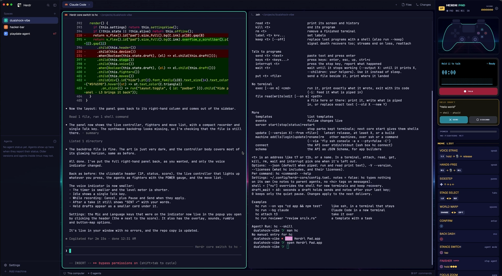

# Pad Arcade

Play Herdr with a DualShock 4. Pad Arcade keeps Herdr's default sidebar and tabs, puts a dark synthwave backdrop behind them, and adds an arcade-style panel on the right. The panel shows:

- a live controller that lights up every button you press,
- a pocket-recorder voice meter: hold L1, talk, release, and the words go to the focused agent,
- your agents as fighters with health bars,
- your controls as a fighting-game move list.

A small helper bundled in the mod reads the controller and the mic. It also moves focus between panes, tabs and spaces, presses keys and sends prompts.

## What you see

- **Window:** `pad-arcade` is a row with three children: the shipped sidebar (268 px), the work column (tabs, panes, status bar) and the `padbar` block (300 px, min 240, max 420).
  - The root background is `mods/pad/backdrop.png`, a navy synthwave grid with a teal, coral, pink and blue horizon. It uses `fit: cover`.
  - The sidebar is `#0e1020d9` so the backdrop shows through. The pane frame is radius 12, with a 1 px `#262b52` border and a 2 px `#3ee0c4` focus ring.
  - The theme is `herdr-pad` (`themes/herdr-pad.json`: background `#12142a`, accent `#3ee0c4`). Its colors are overridden for accent, chrome, canvas, background, surface and border.
- **Pad panel** (`mods/pad`), on `#07081a`, top to bottom:
  1. **Header:** a gold "1P" badge, then "HERDR PAD" in Press Start 2P (white and `#3ee0c4`). Below that, a VT323 status line ("● PAD  MAC MIC  EN"), a six-digit gold SCORE, an "xN COMBO" when the combo is over 1, and a gear icon. Clicking the header opens settings.
  2. **Controller stage:** 276 × 172 with radius 14. The backdrop sits under a vector DualShock built from the `ctl/*.svg` layers (viewBox `-18 -6 356 222.5`).
     - The body has a `#3ee0c4` outline. Idle parts are `#1d2142`; the face symbols keep their own colors.
     - Held buttons light up: L1/L2/R1/R2 gold, the touchpad violet, the D-pad arms white, and the face buttons in their own colors (✕ `#7cb2e8`, ○ `#ff6b6b`, □ `#e79bd9`, △ `#3ee0c4`).
     - The stick caps move up to ±7 px with the sticks.
  3. **Voice recorder:** a `#1b1d24` shell around a black LCD.
     - The top line shows the target (or "Hold L1 to talk") with a ● status word: Ready, Recording, Paused, Transcribing, Sent or Typed.
     - Below that, a 32 px VT323 timer in `#5fd4ff`, and a 46 × 6 dot-matrix meter (3 px dots, 2 px gaps; lit `#5fd4ff`, the top rows `#b8f0ff`, unlit `#0f2a36`).
     - The keys change with the state: Talk (red) when idle; Cancel, Pause and Send (teal) while recording; "Transcribing" (dimmed) while busy.
  4. **Held draft** (only when there is one): a gold-bordered card with the quoted text, its target, and Send and Discard keys.
  5. **Fighters:** a POWER gauge in the controller's lightbar color, then one health bar per agent (up to 5) in the status color.
  6. **Move list:** "MOVE LIST" in gold pixel type, then 13 moves. Each shows its name (gold, or pink for SUPER), a hint, and its input chips. A move's row turns gold while its button is held.
  7. "Hide panel · L3 brings it back".
- **Settings popup** (the same mod, `props.settings`, 260 × 330) has option chips for:
  - Microphone: Mac mic or controller headset
  - Language: English, Tiếng Việt or Auto
  - Floating overlay: Full, Compact or Off
  - Sounds and Rumble
  - Edit button map… and Reload

## How it behaves

- **Agents:** working agents pulse their bar width, blocked agents flash, and done or idle ones are full. A blocked agent makes the helper rumble twice and the stage call out "WARNING!". A finished one calls out "STAGE CLEAR!".
- **Callouts:** each move gets one for 1.5 s, such as "FOCUS ZOOM!", "SIDESTEP!", "SENT! K.O." or "3 HIT COMBO!".
- **Voice, push-to-talk:** hold L1 and the dot blinks and the timer runs. On release, it transcribes with whisper.cpp on this Mac.
  - An agent gets the text as a prompt.
  - A plain shell, or an agent waiting on a question, gets it as a held draft. ✕ sends it and ○ discards it.
- **Voice, hands-free:** tap R1 to start and R1 again to send. The panel's Send key does the same, and Pause stops the meter and the clock.
- **Controls:** the D-pad moves between panes, L2/R2 switch tabs and Share/Options switch spaces. ✕ is Enter, ○ is Esc, □ is Shift-Tab (hold it for Ctrl-C), △ zooms and the touchpad jumps to the agent that needs you. The left stick sends arrow keys and the right stick scrolls. L3 toggles the panel and R3 cycles the language.
- **Score:** every prompt sent adds 100 × the combo. Sends less than 10 minutes apart extend the combo.
- **Start-up:** the panel starts the helper by itself (`mods/pad/herdr-pad --detach`). A lock file keeps it to one copy. If the helper is missing, the panel shows "INSERT COIN" and a Press Start button.

## Built from

- **`layouts/pad-arcade.json`:** a clone of `main`, with `theme: "herdr-pad"`, a root background image, and the `padbar` block `{ "mod": "pad" }` as the last child of `root`. Preview: `layouts/pad-arcade.svg`.
- **`mods/pad/main.js`:** one `View`.
  - It draws stacked `svg()` layers, absolutely positioned and tinted with `text_color`, and `image()` for the backdrop.
  - Animations are native: `.loop("opacity" | "width")` and `.frames()`.
  - It reads `~/.config/herdr-pad/state.json` with `readTextFile` and wakes on `watchFolder`.
  - `exec` runs the helper (`--detach`, `--send <action>`) and `kill -0` for liveness. It also uses `openOverlay` and `closeOverlay` for settings, `run("layout.toggle", {id: "padbar"})`, and `agents()`.
- **`mods/pad/herdr-pad`:** a native Apple Silicon helper (Objective-C), with its Info.plist linked in and its files in `herdr-pad.resources/`.
  - It reads the DualShock over IOKit HID, records the Mac mic with AVAudioEngine (or the controller headset over Bluetooth), and runs `whisper-cli` through `speech.py`.
  - It acts through `herdr-app do` (`pane.go`, `tab.next`, `space.next`, `pane.zoom`, `agent.focus`, `terminal.scroll`, `layout.toggle`) and `hc` (`keys`, `send`).
  - Before calling `hc`, it drops the `HC_*` environment, so prompts arrive untagged.
  - Its source is in this repo (`hud/`, `src/`, built with `make helper`).
- **Assets:**
  - Fonts: Press Start 2P and VT323 (SIL OFL) in `mods/pad/fonts/`.
  - `backdrop.png` and `art.png` were generated with Codex image generation.
  - The SVG icons are original.

## Watch out

- **Install:** the helper is a prebuilt arm64 binary. `install.sh` copies it with the mod. On Intel, or after source changes, run `make helper`.
- **Platform:** macOS only; the controller is read over Bluetooth with IOKit.
- **Voice dependencies:** voice needs `python3`, `whisper-cli` (`brew install whisper-cpp`) and a GGML model at `~/.local/share/whisper/ggml-large-v3-turbo-q5_0.bin` (or `$WHISPER_MODEL`).
- **Permissions:** started by Herdr, the helper uses Herdr's microphone permission. If the mic is denied, the recorder says so.
- **Recording:** the controller-headset mic path depends on the pad's firmware. The Mac mic is the default.
- **Plain shells:** a dictated line is never run by itself; it waits as a held draft.
- **Geometry:** the panel's sizes are fixed for a 300 px column (the stage is 276 px wide).
- **One controller owner:** quit the standalone "Herdr Pad.app" before the panel starts its helper, or the lock makes the second copy exit.

## Done when

- `herdr-app check mods/pad` passes, and `layout.switch {"name":"pad-arcade"}` shows the backdrop, the sidebar and the pad panel.
- With the helper running, pressing ✕ on the pad lights the ✕ layer, gold-highlights the "CONFIRM" move row and calls out "CONFIRM!". Pushing the left stick moves its cap.
- Holding L1, saying a sentence and releasing shows Recording with a moving meter, then Transcribing. Then "SENT ✓" shows the words, and the focused agent receives them as a prompt.
- Clicking the header opens settings. Choosing Tiếng Việt changes the header's language code to VI.
- With the helper killed, the panel shows INSERT COIN, and Press Start brings it back.
